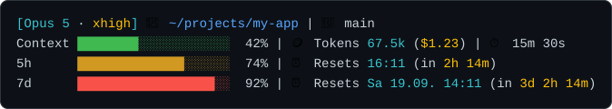

# Claude Code status line

A multi-line status line for [Claude Code](https://code.claude.com) that keeps
the four things you actually look up while working on screen: which model you
are talking to, where you are, how full the context window is, and how much of
your subscription limits is left before each window resets.



One Bash script, no dependencies beyond `jq`, nothing to configure.

## What it shows

| Line      | Contents                                                             |
| :-------- | :------------------------------------------------------------------- |
| 1         | Model with its effort level, working directory, current git branch    |
| 2         | Context-window usage, tokens in context, session cost, elapsed time   |
| `5h`      | The rolling five-hour subscription window                             |
| `7d`      | The weekly subscription window                                        |
| per model | A model-scoped weekly window, labelled with the model name            |

The working directory is shortened to `~` like a shell prompt, and the branch
disappears outside a git repository. The effort level is only shown for models
that support it.

The `5h` and `7d` lines need a Claude.ai subscription. On an API-key account
those windows do not exist and the lines stay away. The per-model line appears
only once the payload carries `rate_limits.model_scoped`, which the CLI does
not send to the status line yet. The block is in place for when it does.

## Reading the limit lines

Bars run green, turn yellow at 70%, and red at 90%. Behind the bar, `⏰ Resets`
gives the local wall-clock time the window resets, with the time left in
brackets:

| The reset falls on | Shown as                         |
| :----------------- | :------------------------------- |
| today              | `16:11 (in 2h 14m)`              |
| a later day        | `Sa 19.09. 14:11 (in 3d 2h 14m)` |
| already past       | `now`                            |

The countdown drops the leading units that are zero, so it reads `in 14m`,
`in 2h 14m`, or `in 3d 2h 14m`. Weekday and date follow the terminal's
`LC_TIME`, so they appear in your own locale.

Colour carries the same meaning everywhere: cyan for a value you read (the
model, the token count, the reset time), amber for anything that costs you
(session cost, effort level, the countdown).

## Requirements

- Bash, and `jq` to parse the status-line JSON (`apt install jq`, `brew install jq`)
- A terminal with truecolor support for the exact amber; without it the script falls back to ANSI yellow
- GNU or BSD `date` — both are handled, so Linux and macOS work the same

## Install

1. Download the script:

   ```bash
   mkdir -p ~/.claude
   curl -fsSL https://raw.githubusercontent.com/dandjo/claude-code-cli-status-line/main/statusline-command.sh \
     -o ~/.claude/statusline-command.sh
   ```

2. Add the `statusLine` key to `~/.claude/settings.json`, leaving every other
   setting alone:

   ```json
   {
     "statusLine": {
       "type": "command",
       "command": "bash ~/.claude/statusline-command.sh"
     }
   }
   ```

3. Start a Claude Code session. The status line appears at the bottom.

To update later, run the same `curl` again. The setting stays as it is, only
the script changes.

## Let Claude install it

Paste this into a Claude Code session instead of running the steps by hand:

```text
Install this Claude Code status line for me:
https://github.com/dandjo/claude-code-cli-status-line

1. Download statusline-command.sh from the repo's main branch to
   ~/.claude/statusline-command.sh. Use the repo copy as-is — do not write
   your own status line and do not merge anything from an existing file.
2. Ensure ~/.claude/settings.json contains:
     "statusLine": { "type": "command", "command": "bash ~/.claude/statusline-command.sh" }
   Add the key if it is missing; leave every other setting untouched.
3. The script needs jq. If it is not installed, tell me the install command
   for my system instead of installing it yourself.
4. Feed a sample status-line payload into the script and show me the rendered
   output, including the 5h and 7d lines, so I can see it works.
```

## Customizing

Everything worth changing sits at the top of the script:

- `BAR_WIDTH` is the bar length in characters, 20 by default
- `CYAN`, `GREEN`, `YELLOW`, `RED` are plain ANSI codes
- `MONEY` is the amber used for cost, effort, and the countdown, matching the colour Claude Code's own dark theme uses for its mode indicator
- the two thresholds that colour a bar live in `render_bar`, at 70 and 90

The layout of each line is a single `printf` near the bottom of the file, so
reordering or dropping a field is a one-line change.

## Testing a change

The script reads one JSON object on stdin and writes the status line to
stdout, so you can exercise it without starting a session:

```bash
echo '{"model":{"display_name":"Opus 5"},"cost":{"total_cost_usd":1.23,"total_duration_ms":930000},"context_window":{"used_percentage":42,"total_input_tokens":67512},"workspace":{"current_dir":"'"$PWD"'"},"rate_limits":{"five_hour":{"used_percentage":31,"resets_at":'"$(($(date +%s)+7200))"'}}}' \
  | bash statusline-command.sh
```

Vary `used_percentage` to see the colour thresholds, and move `resets_at`
further out to see the countdown switch to days.

## When something looks wrong

| Symptom                                | Cause                                                                                    |
| :------------------------------------- | :---------------------------------------------------------------------------------------- |
| No status line at all                  | `statusLine` missing from `~/.claude/settings.json`, or the path in `command` does not exist |
| Every value is `0`                     | `jq` is not installed                                                                      |
| No `5h` / `7d` lines                   | Expected on API-key accounts — those windows only exist for Claude.ai subscriptions         |
| No per-model line                      | Expected — the CLI does not send `rate_limits.model_scoped` to the status line yet          |
| Cost and effort level are plain yellow | The terminal does not report truecolor, so the script falls back to ANSI yellow              |
| Boxes instead of icons                 | The terminal font has no emoji coverage; replace the icons in the `printf` calls            |

The full payload schema is documented at
<https://code.claude.com/docs/en/statusline>.

## License

[0BSD](LICENSE). Use it, change it, ship it. No attribution required, so the
copy in your `~/.claude` carries no obligations at all.
